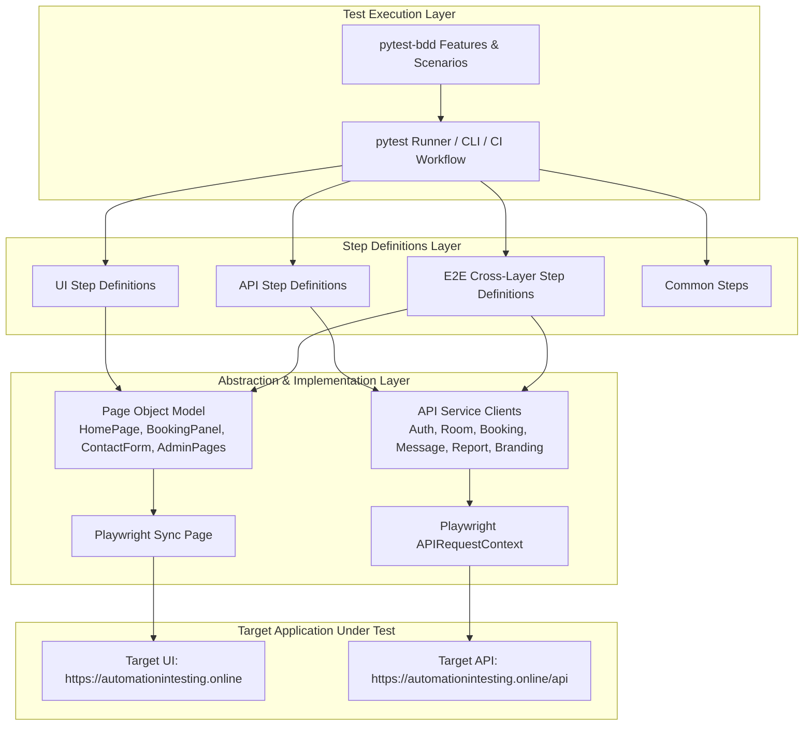

# Restful Booker Platform Test Automation Framework

Enterprise-grade UI, API, and End-to-End test automation framework built for the **Restful Booker Platform** using **Python**, **Playwright (sync API)**, and **pytest-bdd (Gherkin)**.

[](https://github.com/sameertatework1-lgtm/Interview_project/actions/workflows/tests.yml)
[](https://www.python.org/)
[](https://playwright.dev/)
[](https://github.com/allure-framework/allure-python)
[](https://github.com/astral-sh/ruff)

> **Quick Start for Hiring Reviewers:** See [docs/REVIEWER_GUIDE.md](docs/REVIEWER_GUIDE.md) for a 2-minute quick-start guide, local execution commands, and the Top 10 files to review first.

---

## 1. Architecture Overview



---

## 2. Key Framework Features

- **Multi-Layer Coverage**: 83 Manual Test Cases mapped 1:1 to automated Gherkin scenarios (`@ui`, `@api`, `@e2e`).
- **Playwright APIRequestContext**: API tests use Playwright's native HTTP client with auto-attaching request/response payloads to Allure reports on failure.
- **Strict Separation of Concerns**: Page Objects contain locators and page actions; steps contain assertions. No raw selectors inside step definitions.
- **Zero Sleep Policy**: Never uses `time.sleep()` or `wait_for_timeout()`. Relies strictly on Playwright's auto-waiting and web-first assertions.
- **Dynamic Data Factories**: Unique timestamped identifiers with `AUTO_` prefixes ensure clean runs without colliding on a public shared demo.
- **Automated Teardown & Self-Healing Cleanup**: Teardown hooks clean up created rooms, bookings, and messages via API even if assertions fail.
- **Shared Demo Resilience**: Dynamic session token caching and fallback health-checks ensure resilience against periodic 10-minute demo resets.

---

## 3. Quick Start & Local Setup

### Prerequisites
- Python 3.11 or later
- Git

### Installation
```powershell
# 1. Clone repository
git clone <repo-url>
cd Interview_Project

# 2. Create and activate virtual environment
python -m venv .venv
.venv\Scripts\activate   # Windows
# or: source .venv/bin/activate (macOS/Linux)

# 3. Install pinned dependencies
pip install -r requirements.txt

# 4. Install Playwright browser binaries
playwright install chromium

# 5. Configure environment
copy .env.example .env
```

---

## 4. Test Execution Commands

```powershell
# Run smoke tests only (critical path)
pytest -m smoke -v

# Run API test suite
pytest -m api -v

# Run UI test suite in headed mode
pytest -m ui --headed

# Run End-to-End cross-layer tests
pytest -m e2e -v

# Run regression tests with 2 parallel workers
pytest -m regression -n 2

# Generate and view Allure report
pytest --alluredir=reports/allure
allure serve reports/allure

# Code quality and linting
ruff check .
ruff format --check .
```

---

## 5. Test Markers & Tags

Every scenario includes tags corresponding to the test case sheet:
- `@smoke`: Critical user journeys and smoke checks.
- `@regression`: Comprehensive regression suite.
- `@api`: API-layer tests (zero browser overhead).
- `@ui`: Browser-based tests.
- `@e2e`: Cross-layer tests verifying API setup against UI and vice versa.
- `@negative`: Validation, error-handling, and negative flows.
- `@boundary`: Field length and boundary value testing.
- `@security`: Authentication, authorization, and session invalidation.
- `@contract`: JSON schema contract validations.
- `@nfr`: Non-functional performance and header assertions.

---

## 6. Project Layout

```
.
├── config/
│   └── settings.py               # Env-driven configuration (urls, creds, timeouts)
├── src/
│   ├── api/                      # Service clients (AuthAPI, RoomAPI, BookingAPI, etc.)
│   ├── pages/                    # Page Objects (BasePage, HomePage, AdminPages)
│   ├── data/                     # factories.py (Unique test data builders)
│   ├── schemas/                  # JSON schema contracts
│   └── utils/                    # logger.py, waits.py, assertions.py
├── features/
│   ├── api/                      # Gherkin .feature specifications for API
│   ├── ui/                       # Gherkin .feature specifications for UI
│   └── e2e/                      # Gherkin .feature specifications for E2E
├── tests/
│   ├── conftest.py               # Pytest fixtures, hooks, health checks, reporting
│   ├── step_defs/                # Step definitions implementing Gherkin steps
│   ├── test_api.py               # API scenarios runner
│   ├── test_ui.py                # UI scenarios runner
│   └── test_e2e.py               # E2E scenarios runner
├── docs/
│   ├── DISCOVERY.md              # Real environment discovery findings & API quirks
│   ├── DECISIONS.md              # Architectural decisions (D-001 through D-009)
│   ├── TRACEABILITY.md           # 1:1 Manual test cases to automated scenarios matrix
│   ├── WALKTHROUGH.md            # Plain-language architectural guide for interviewers
│   └── discovery_samples/        # Raw captured JSON response samples
└── .github/workflows/tests.yml   # CI workflow
```

---

## 7. Known Environment Limitations

1. **Broken Actuator Health Endpoint (`/api/auth/actuator/health`)**:
   The live demo server returns HTTP 500 on actuator health queries. Framework uses `/api/room` for session health and marks `API-001` with `xfail`.
2. **Trailing Slash Strip on Railway Reverse Proxy**:
   Calling endpoints with trailing slashes (e.g. `/api/room/`) triggers a 308 redirect that strips the `Cookie` authorization header. All API clients omit trailing slashes.
3. **Missing Graceful 404 on Unknown IDs**:
   Requesting non-existent entities (e.g. `/api/room/999999`) throws an unhandled server exception (HTTP 500). Assertions accommodate both HTTP 404 and 500.
